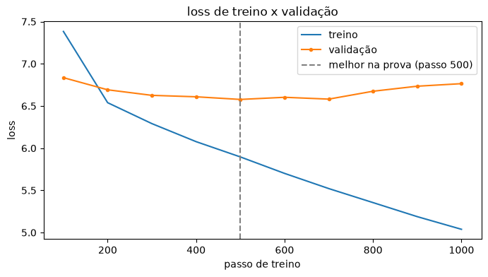

# minha primeira LLM

Queria entender de verdade como um modelo de linguagem funciona por dentro, então resolvi montar um do zero.

Comecei pelo básico (como transformar texto em número) e terminei treinando um RoBERTa com o livro *Crepúsculo dos Ídolos*, do Nietzsche. O tokenizer e o modelo começam sem saber nada e aprendem só com esse livro.

Tudo está no notebook [`Minha_primeiraLLM.ipynb`](Minha_primeiraLLM.ipynb).

O modelo treinado está publicado no Hugging Face: [ArthurBenedett/roberta-nietzsche-pt](https://huggingface.co/ArthurBenedett/roberta-nietzsche-pt). Dá pra testar direto no navegador.

## o que tem no notebook

1. uma "cifra" que transforma letra em número (e quebra quando aparece letra que ela nunca viu)
2. one-hot com palavras inteiras, e por que isso não escala
3. tokens com o `tiktoken` do GPT-2, que picota o português bem mais que o inglês
4. a diferença entre o jogo do GPT (próxima palavra) e o do BERT (preencher lacuna)
5. um tokenizer Byte-Level BPE treinado com o livro: numa frase de teste ele usa 11 tokens, contra 21 do GPT-2
6. um RoBERTa pequeno (4,5 milhões de parâmetros) treinado do zero, rodando no meu PC sem GPU
7. **validação**: os últimos 10% do livro ficam de fora do treino e servem de prova, com early stopping
8. **boletim**: curva de loss de treino x validação, perplexidade e acerto top-1/top-5, comparando o modelo com dois chutes bobos (aleatório e pela frequência das palavras)
9. testes com `<mask>` pra ver o que ele aprendeu

## como ficou

Resultado nas 584 lacunas da validação (texto que o modelo nunca viu):

| | loss | perplexidade | acerto top-1 | acerto top-5 |
|---|---|---|---|---|
| **meu modelo** | **6,58** | **722** | **10,6%** | **19,2%** |
| chute pela frequência | 6,77 | 870 | 7,0% | 15,2% |
| chute aleatório | 8,52 | 5.008 | 0,0% | 0,1% |



O que isso mostra:

- **ele decora rápido.** A validação parou de melhorar no passo 500 (época ~31). Depois disso o loss de treino seguiu caindo (5,9 → 5,0) e o de validação subiu (6,58 → 6,76). O early stopping cortou no passo 1000 e ficou com a versão do passo 500.
- **no texto novo, ganha do chute pela frequência, mas por pouco**: perplexidade 722 contra 870.
- **a versão antiga me enganou.** Eu treinava 300 épocas olhando só o loss de treino, que chegava em 1,3 e parecia ótimo. Era o modelo decorando o livro. Sem uma prova separada eu nunca teria percebido.

Nos testes com frases ele chuta quase sempre "," e "de", até na frase "o que não me faz morrer me torna mais forte", que estava no treino. Com um livro só (26 mil palavras) não tem texto suficiente pra ele aprender o sentido sem decorar. O próximo passo é treinar com muito mais texto.

## como rodar

Python 3 e Jupyter.

```bash
pip install -r requirements.txt
```

Depois é só abrir o notebook e rodar de cima pra baixo (*Restart & Run All*). O livro é baixado sozinho. As sementes são fixas, então o resultado se repete. No CPU o treino leva uns 8 minutos (o early stopping para antes das 300 épocas).

## créditos

Segui a aula [LLM na Prática](https://www.youtube.com/watch?v=LphBQB1amrw) do Prof. Marlon Ferrari ([repo original](https://github.com/ferrarimarlon/NietzscheLLM)) e adaptei algumas coisas: modelo menor pra caber no CPU, menos épocas, o livro inteiro cortado em blocos em vez de linha por linha, o teste do `<mask>` montado na mão em vez do `pipeline`, e a validação com boletim e comparação com chutes bobos.
